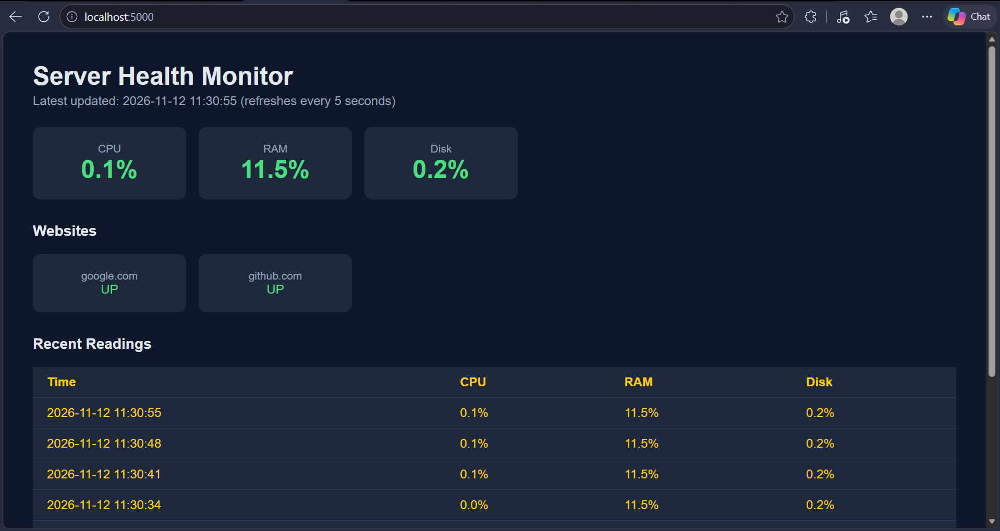
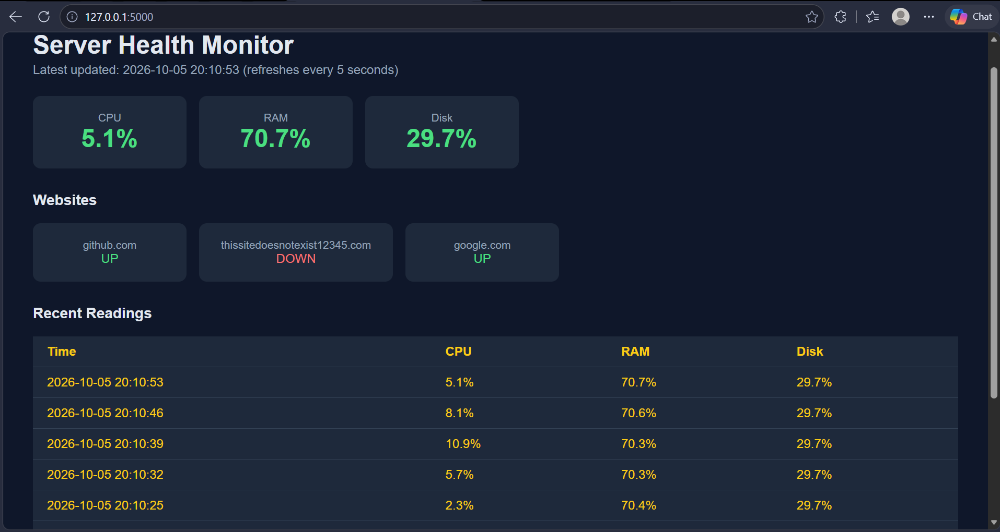
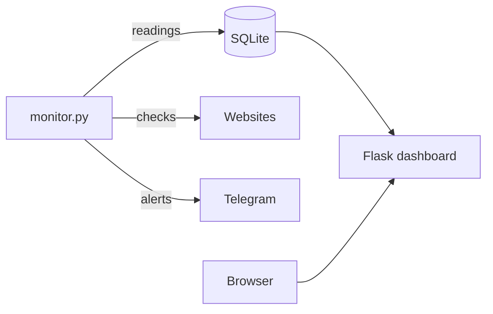
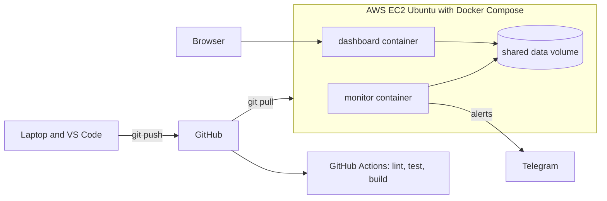

# Server Health Monitor


A Python tool that monitors a machine's CPU, RAM and disk usage, checks whether websites are up, logs everything, stores readings in a database, and shows live results on a web dashboard.



   *When a monitored site goes down, its card turns red:*



## Features

- Reads CPU, RAM and disk usage with `psutil`
- Checks website availability (UP / DOWN) with `requests`
- Prints warnings when CPU, RAM or disk cross a set limit
- Writes timestamped logs to `monitor.log`
- Stores every reading in a SQLite database (`monitor.db`)
- Flask web dashboard that refreshes every 5 seconds, with cards that turn red when a limit is crossed

## Architecture



### Deployment architecture


## Tech stack

## Tech stack

Python, psutil, requests, Flask, SQLite, pytest, Docker and Docker Compose, GitHub Actions, AWS EC2 (Ubuntu), Telegram Bot API

## Project structure

## Project structure

| File | Purpose |
|---|---|
| `monitor.py` | Collects readings, checks websites, logs, saves to the database and sends alerts |
| `dashboard.py` | Flask web app that shows the latest readings and website status |
| `show_data.py` | Prints the latest rows from the database (quick check) |
| `test_monitor.py` | Automated tests (pytest) |
| `Dockerfile` | Builds the container image |
| `docker-compose.yml` | Runs the monitor and the dashboard together |
| `.github/workflows/ci.yml` | GitHub Actions pipeline: lint, test, Docker build |
| `config.example.py` | Template for the Telegram secrets file |
| `requirements.txt` | Python libraries needed |

## How to run (Windows)

1. Clone the repo and open the folder:
```
   git clone https://github.com/anurag-dubeyy/server-health-monitor.git
   cd server-health-monitor
```
2. Create and activate a virtual environment, then install the libraries:
```
   python -m venv venv
   venv\Scripts\activate
   pip install -r requirements.txt
```
3. Start the monitor in one terminal:
```
   python monitor.py
```
4. Start the dashboard in a second terminal (activate the venv there too):
```
   python dashboard.py
```
5. Open http://127.0.0.1:5000 in your browser.

## Run with Docker

1. Copy `config.example.py` to `config.py` and fill in your Telegram token and chat ID.
2. Start everything:
   ```
   docker compose up --build -d
   ```
3. Open http://localhost:5000
4. Stop it with:
   ```
   docker compose down
   ```
## Telegram alerts (optional)

1. Create a bot with @BotFather and note its token.
2. Put the token and your chat ID in `config.py`.
3. `config.py` is ignored by Git, so your secrets stay private.

## Deployment

Deployed on an AWS EC2 Ubuntu server with Docker Compose. The security group only allows SSH and the dashboard port from my IP, containers restart automatically after a reboot, and GitHub Actions runs lint, tests and a Docker build on every push.
   

## Roadmap

- [x] System monitoring (CPU, RAM, disk)
- [x] Website up/down checks
- [x] Logging and threshold warnings
- [x] SQLite storage
- [x] Web dashboard
- [x] Website status on the dashboard
- [x] Telegram alerts
- [x] Docker container
- [x] CI/CD with GitHub Actions
- [x] Deployment on a Linux cloud server

## What I learned
- Structuring a Python project and testing it with pytest, including mocking network calls
- Containerizing an app with Docker Compose and sharing data between containers with a volume
- Setting up CI with GitHub Actions (lint, tests, Docker build)
- Deploying to an AWS EC2 Ubuntu server and locking down access with a security group
- Keeping secrets out of Git, and responding to a leaked-token scare by revoking and rotating it
- Debugging real errors: SSH key permissions, YAML and Dockerfile typos, a crash-looping container

## Why I built this

I'm a second-year BSc Computer Science student learning Python and DevOps from scratch. I built this project step by step to learn Python, Git, databases and web apps, and I'm extending it with Docker, CI/CD and cloud deployment.